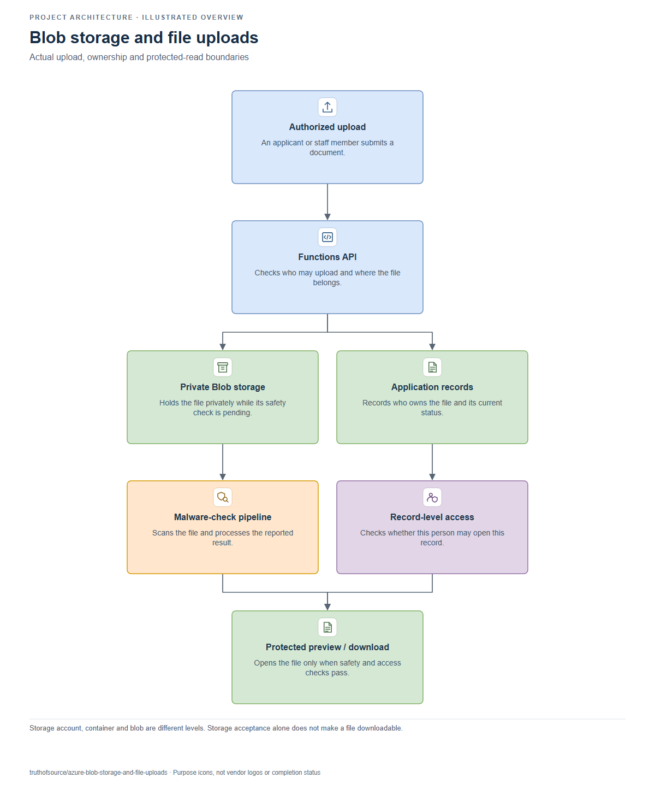

# Azure Storage Accounts, Containers and File Uploads

[](docs/diagrams/architecture.svg)

[View SVG](docs/diagrams/architecture.svg) · [Download PNG](docs/diagrams/architecture.png) · [Edit in draw.io](docs/diagrams/architecture.drawio)

**Keep business files organized, restrict who can open them and prepare for accidental changes or deletion.**

[Business problem](#the-business-problem) · [Solution](#the-solution) · [What was built](#what-was-built) · [Proof](#proof-it-works) · [Commands](docs/COMMANDS.md) · [Step by step](#step-by-step)

## The Business Problem

HR and operations staff need to upload, find and retrieve employee and business documents from one application. A file left in storage with only a technical filename gives little context about its owner, document type or purpose. A document list becomes difficult to trust if those links are inconsistent.

Uploads can be interrupted or repeated, files can be replaced and accidental deletion can affect records used later for review. Access must follow the person and business record, including when the user requests a direct preview or download. A newly stored file also needs a visible processing status while its malware check is pending.

The business need was an organized document library backed by consistent ownership, controlled upload and download paths and defined retention and recovery behavior.

## The Solution

I used Azure Blob Storage to hold uploaded files, with application records that identify their owner, type and processing status. New uploads wait for a malware check, and the application checks access again when someone opens or downloads a file.

**Business outcome:** Staff have a consistent document library, clearer access rules and recovery options for retained files. The project does not claim measured time savings.

In Azure, a storage account manages settings, a container groups files, and a blob is a stored file. The application database keeps the business information about those files.

## Tools Used and What They Do

| Tool or service | What it does | Where it fits |
| --- | --- | --- |
| Azure Blob Storage | Store private document bytes and supported retained versions. | Actual file store. |
| Microsoft Entra ID and managed identities | Authenticate staff/services before their permitted operations. | Actual identity layer; data roles and record authorization remain separate. |
| Azure Functions, Node.js and TypeScript | Validate uploads, document ownership and protected reads. | Actual application rules; only selected code is included. |
| Defender for Storage, Event Grid and Storage Queues | Scan files and carry the resulting work to the processor. | Actual platform pipeline; the local example does not perform a cloud scan. |
| Terraform | Describe storage and diagnostic settings. | Reference infrastructure with local validation, not a new live file service. |
| Node test runner and Python | Exercise extracted rules and show a fictional file library. | Public validation and demonstration utilities. |

Account visibility in Azure is different from permission to read a blob or the employee record that owns it. Manual GitHub Actions validation does not upload business files.

## Step by Step

Your own private Blob container, an Entra-authenticated upload, version/retention settings and an upload/download verification.

[Open the standalone build guide](docs/BUILD-YOUR-OWN.md) or follow the same complete instructions below.

Start with a new folder, your own files and your own accounts. The numbered steps below describe the build; no portfolio repository checkout is required. The existing implementation/evidence elsewhere in this repository is a separate reference, not a claim that your new build has already passed.

### Prerequisites

Azure CLI; a dedicated subscription/resource group; permission to create storage and assign your own scoped Blob data role. Use a harmless text file, not employee documents.

Use Bash on Linux/macOS/WSL for Bash blocks and PowerShell for PowerShell blocks. Select the tool versions supported by the official sources below, record the versions you actually install and retain generated dependency locks. Cloud resources, scanner downloads, logs and external AI calls can create costs; review the stated scope before enabling them.

### Create your project folder

Choose a new folder name. These first commands create a blank project; an optional `git init` gives it its own history. Create parent directories in your editor when a later step introduces a nested file.

```bash
mkdir my-azure-blob-storage-and-file-uploads
cd my-azure-blob-storage-and-file-uploads
git init
```

Create `.gitignore` before saving credentials or build outputs:

```gitignore
.venv/
node_modules/
.env
.env.*
local.settings.json
credentials.json
token.json
*.pem
*.key
*.tfstate*
*.tfplan
.terraform/
private*/
captures/
backups/
batch.json
reports/
out/
app-config.local.yaml
```

The source/file snippets are a starting implementation you type or paste into the named files. Replace `YOUR_*`, names, regions and addresses only with values from your own lab; do not place real client/employee records in a test project. Keep your terminal in this project root unless a step explicitly changes directory.

Before a first commit, set your own repository-local author with `git config user.name "YOUR_NAME"` and `git config user.email "YOUR_PUBLIC_COMMIT_EMAIL"`. Review `git status --short` and the staged diff before publishing; ignored local files are not a substitute for reviewing what you upload.

### Step 1 — Create an account and define its access boundary

**Where:** Azure Portal → Storage accounts → Create.

Create a new StorageV2 account with TLS 1.2 or later, anonymous Blob access disabled and Shared Key disabled. On Networking choose your approved access path; for a workstation lab, Selected networks plus your exact public IP is different from a private endpoint.

**Check before continuing:** You know which network caller is allowed and have not opened anonymous access.

### Step 2 — Grant only the upload role

**Where:** Storage account → Access control (IAM).

Assign Storage Blob Data Contributor at this lab account or container scope to your own test identity. Management Contributor alone is not a Blob data read/write grant; wait for propagation instead of using account keys.

**Check before continuing:** The named identity and exact data scope are visible in IAM.

### Step 3 — Create the container and retention policy

**Where:** Storage account → Data storage → Containers; Data management → Data protection.

Create a private container named documents. Enable versioning and choose your own blob/container soft-delete periods after considering storage costs and the project retention requirement.

**Check before continuing:** The container is private and the selected recovery settings are recorded.

### Step 4 — Create and upload your own harmless file

**Where:** Your new project folder, Bash / WSL.

Create hello.txt and upload it through Entra login. Replace the account name below with your own; keep the file private and use overwrite=false for a new object.

```bash
printf 'My upload test
' > hello.txt
az login
az storage blob upload --account-name "YOUR_ACCOUNT" --container-name documents   --name hello.txt --file hello.txt --auth-mode login --overwrite false
az storage blob show --account-name "YOUR_ACCOUNT" --container-name documents   --name hello.txt --auth-mode login --query '{etag:properties.etag,length:properties.contentLength}'
```

**Check before continuing:** The upload returns success and the private blob exists.

### Step 5 — Verify content and an unauthorized request

**Where:** Your terminal and a separate unauthenticated client.

Download the file with the permitted identity and compare its SHA-256 with the original. Open its ordinary blob URL without credentials and confirm the content is not disclosed; record network denial separately from identity denial.

```bash
az storage blob download --account-name "YOUR_ACCOUNT" --container-name documents   --name hello.txt --file downloaded.txt --auth-mode login
sha256sum hello.txt downloaded.txt
```

**Check before continuing:** The permitted download matches the upload, and the unauthenticated request does not return its contents.

### Step 6 — Exercise recovery and clean up

**Where:** Storage Explorer / Azure Portal.

Delete only the test blob, recover it through the selected soft-delete/version interface, and verify its contents again. Record the recovery result and remove this isolated lab after reviewing retained versions, soft-deleted data and costs.

**Check before continuing:** You have upload, denied-access and recovery evidence from your own account.

### Verification and your own screenshots

| Evidence | What to record | Your result |
| --- | --- | --- |
| New build | Your own files/resource settings and tool versions | Not yet recorded |
| Working path | The actual successful request, configuration or recovery result | Not yet recorded |
| Failure boundary | A meaningful denied, malformed, stale or failed case | Not yet recorded |
| Recovery / cleanup | What you restored or removed and what remains billed | Not yet recorded |

Capture your own architecture/configuration, one working result and one failure/recovery result. Keep tokens, credentials, personal records and private identifiers out of public screenshots. The architecture diagram explains the design; record your own results rather than treating it as execution evidence.

### Troubleshooting order

1. Confirm the named file, working directory and selected tool/interpreter.
2. Check the exact input and resource/account selected for the failing step.
3. Separate identity permission, network/DNS reachability and application validation.
4. Keep the actual error and reconcile an unknown write outcome before repeating it; do not widen access or repeat paid operations blindly.

The numbered steps describe a build procedure. Local syntax checks, an accepted API request, a completed hosted operation and a human verification are different evidence levels; fill in the verification table with what you actually observed.

### Official implementation references

- [learn.microsoft.com — authorize-data-operations-cli](https://learn.microsoft.com/en-us/azure/storage/blobs/authorize-data-operations-cli)
- [learn.microsoft.com — soft-delete-blob-overview](https://learn.microsoft.com/en-us/azure/storage/blobs/soft-delete-blob-overview)

The walkthrough layout follows the prerequisites → creation/configuration → test → verification → troubleshooting → cleanup pattern of the [Splunk project reference](https://github.com/davidharris6/splunk-siem-log-analysis). Its Splunk-specific settings are not copied into unrelated projects.

<details>
<summary>Reference: how the existing platform implementation operates</summary>

A short walkthrough of the process, with technical instructions and evidence limits in the sections below.

1. **Check the upload request** — The application checks the user, document type and file details. It also confirms that the selected record may be changed.

2. **Store the file and its details (Blob Storage)** — The new file goes into protected storage while the database records its owner and status. Saved upload details help distinguish a retry from a different file.

3. **Wait for the malware result (Defender for Storage)** — A separate process checks the uploaded file for malware. An uncertain or unsuccessful check does not make the file available.

4. **Open or recover the document** — The application checks access again before a preview or download. Retained file versions and deletion recovery support a separate recovery process after mistakes.

</details>

## Architecture

[View the illustrated project overview](docs/diagrams/architecture.svg).

## What Was Built

| Part | What it does | Details |
| --- | --- | --- |
| File storage | Groups files privately and records earlier versions for recovery. | [Storage setup](infra/storage/main.tf) |
| Upload checks | Checks size, file type and whether the selected record may be changed. | [Upload rules](src/contracts/publicStage2DocumentUpload.ts) |
| Filing rules | Chooses a collection based on the document type. | [Document catalog](src/documents/documentCatalog.ts) |
| Access checks | Separates HR, Payroll and Admin document access. | [Permission rules](src/documents/documentAccess.ts) |
| Retry records | Checks whether a repeated request is the same upload or different content. | [Upload records](reference/documentUploadReceipt.ts) |

This project covers application uploads. [Email ingestion](https://github.com/truthofsource/azure-logic-apps-document-ingestion) and [malware scanning](https://github.com/truthofsource/secure-serverless-document-processing) have separate case studies.

## Proof It Works

**34 recorded application-rule tests passed**, covering accepted and rejected uploads, role restrictions and protected records. **Five infrastructure test cases** also passed using simulated Azure responses.

The screenshots show fictional documents in a local demonstration. These checks did not deploy a complete file-storage service or repeat live recovery. [What was checked](docs/VALIDATION.md).

<details>
<summary>For engineers: detailed results, examples and commands</summary>

### 1. Check actual application rules

```bash
npm test
npm run demo
```

**Observed: 34 tests passed.** They include valid and rejected uploads, role restrictions, accepted-document protection and safe audit fields. Node runs the selected TypeScript files without installing application packages. This is not a full application build or TypeScript type check.

### 2. Check the storage configuration without Azure

```bash
terraform -chdir=infra/storage init -backend=false
terraform -chdir=infra/storage fmt -check -recursive
terraform -chdir=infra/storage validate
terraform -chdir=infra/storage test
```

**Observed: five simulated-provider tests passed**, along with formatting and configuration validation. They check proposed settings without contacting an Azure account. [Validation](docs/VALIDATION.md) records results and limitations.

### 3. Follow an upload

A valid upload request does not mean the file is safe to open. The full application waits for a check of the exact uploaded file version. A retry must match the saved upload record. It cannot submit a different file as the same request.

### 4. Check who can see what

The library filters by document type, even when types share a container. These API rules do not reduce the separate permissions of someone granted direct storage access.

```bash
python -B scripts/preview.py --port 8140
```

Open [the local reference](http://127.0.0.1:8140). Screenshots are real captures of this local demonstration with fictional data, not Azure Portal or live application evidence.

</details>

## Strengths, Weaknesses and Tradeoffs

| Benefit | What it does not solve by itself |
| --- | --- |
| Consistent filing by document type | Each document still needs the correct owner and access checks. |
| Saved upload records | The file store and business database still need to agree after a partial failure. |
| Earlier versions and deletion recovery | Recovery is limited by retention settings and does not restore the whole application. |
| Activity records | Logs need appropriate access, retention and cost controls. |

For more or larger uploads, measure file sizes, waiting work, scan times and retained storage. Increasing an upload limit alone is not a complete scaling plan. [Operations, recovery and growth](docs/OPERATIONS-AND-SCALING.md).

## Troubleshooting Lessons

Removing a visible report did not automatically clear retained blob versions. Exact ownership, version identity and soft-deletion boundaries had to be preserved during cleanup. [Read the incident, evidence and verification](docs/LESSONS-LEARNED.md).

## Project Guides

| Guide | Purpose |
| --- | --- |
| [Implementation](docs/IMPLEMENTATION.md) | Accounts, containers, upload rules and access boundaries |
| [Commands](docs/COMMANDS.md) | Local validation and read-only Azure inspection examples |
| [Operations and scaling](docs/OPERATIONS-AND-SCALING.md) | Failure handling, recovery, costs and growth |
| [Source map](docs/SOURCE-MAP.md) | Actual source, adaptations and original file hashes |
| [Validation](docs/VALIDATION.md) | What the checks prove and what they do not |

No cloud resources were deployed or started for this project. The GitHub check is manual-only and is not dispatched as part of publication.
