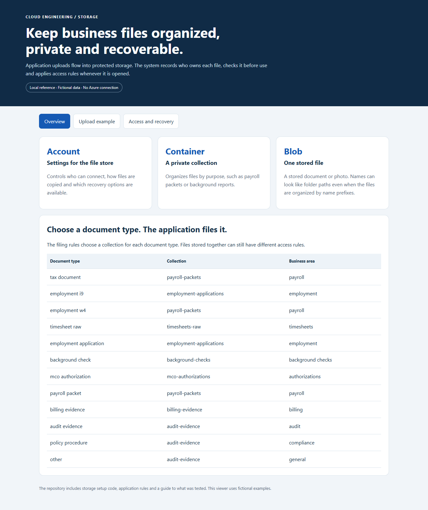
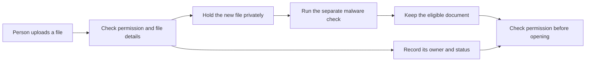
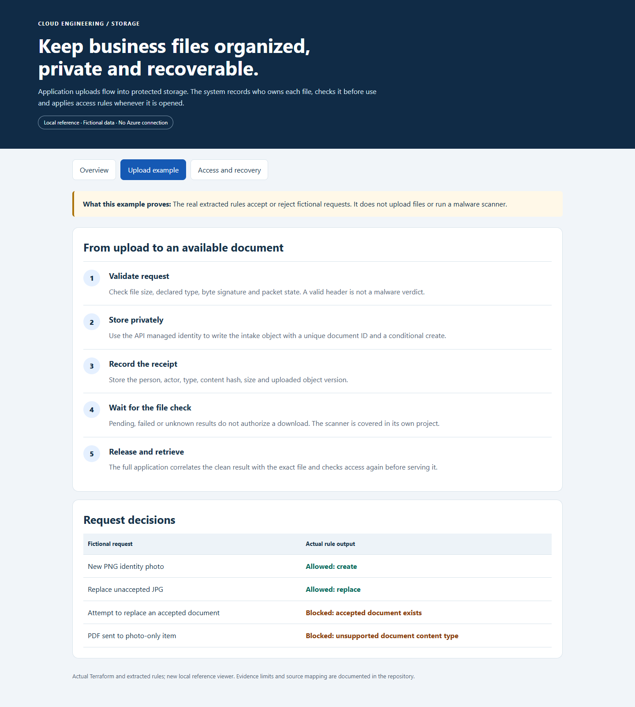
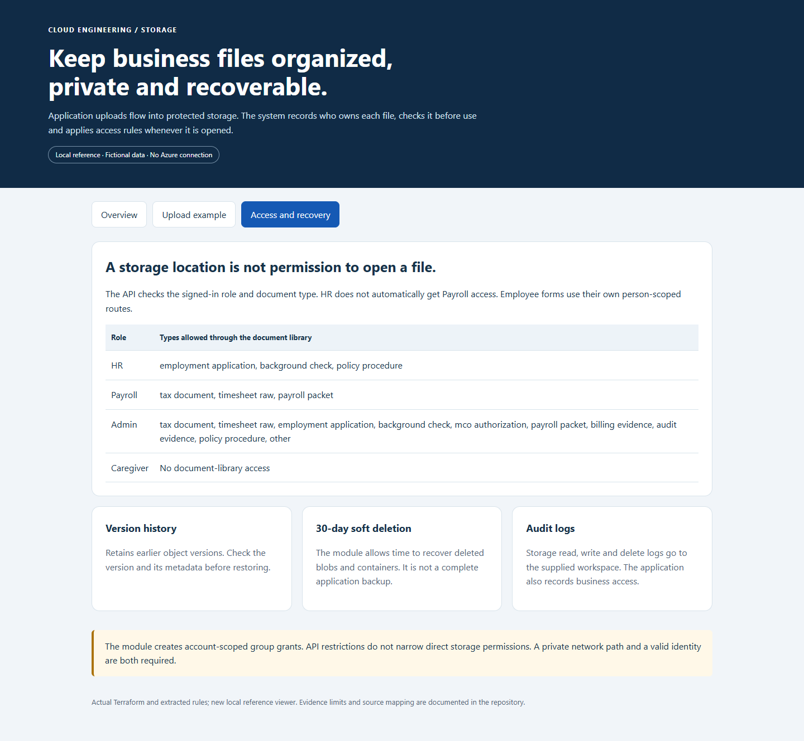

# Azure Storage Accounts, Containers and File Uploads

**Keep business files organized, restrict who can open them and prepare for accidental changes or deletion.**

[Business problem](#the-business-problem) · [Solution](#the-solution) · [What was built](#what-was-built) · [Proof](#proof-it-works) · [Commands](docs/COMMANDS.md) · [Step by step](#step-by-step)



## The Business Problem

Uploading a file is only the start. Staff need to find it, know whose record it belongs to and avoid opening an unchecked or unauthorized copy. The organization also needs a way to recover files after mistakes.

## The Solution

I used Azure Blob Storage to hold uploaded files, with application records that identify their owner, type and processing status. New uploads wait for a malware check, and the application checks access again when someone opens or downloads a file.

**Business outcome:** Staff have a consistent document library, clearer access rules and recovery options for retained files. The project does not claim measured time savings.

In Azure, a storage account manages settings, a container groups files, and a blob is a stored file. The application database keeps the business information about those files.

## Tools Used and What They Do

| Tool or service | What it does | Where it fits |
| --- | --- | --- |
| Azure Blob Storage | Store private document bytes and supported retained versions. | Actual file store. |
| Microsoft Entra ID and managed identities | Authenticate staff/services before their permitted operations. | Actual identity layer; data roles and record authorization remain separate. |
| Azure Functions, Node.js and TypeScript | Validate uploads, document ownership and protected reads. | Actual application rules; only selected code is included. |
| Defender for Storage, Event Grid and Storage Queues | Scan files and carry the resulting work to the processor. | Actual platform pipeline; the local example does not perform a cloud scan. |
| Terraform | Describe storage and diagnostic settings. | Reference infrastructure with local validation, not a new live file service. |
| Node test runner and Python | Exercise extracted rules and show a fictional file library. | Public validation and demonstration utilities. |

Account visibility in Azure is different from permission to read a blob or the employee record that owns it. Manual GitHub Actions validation does not upload business files.

## Step by Step

A short walkthrough of the process, with technical instructions and evidence limits in the sections below.

1. **Check the upload request** — The application checks the user, document type and file details. It also confirms that the selected record may be changed.

2. **Store the file and its details (Blob Storage)** — The new file goes into protected storage while the database records its owner and status. Saved upload details help distinguish a retry from a different file.

3. **Wait for the malware result (Defender for Storage)** — A separate process checks the uploaded file for malware. An uncertain or unsuccessful check does not make the file available.

4. **Open or recover the document** — The application checks access again before a preview or download. Retained file versions and deletion recovery support a separate recovery process after mistakes.

## Architecture



## What Was Built

| Part | What it does | Details |
| --- | --- | --- |
| File storage | Groups files privately and records earlier versions for recovery. | [Storage setup](infra/storage/main.tf) |
| Upload checks | Checks size, file type and whether the selected record may be changed. | [Upload rules](src/contracts/publicStage2DocumentUpload.ts) |
| Filing rules | Chooses a collection based on the document type. | [Document catalog](src/documents/documentCatalog.ts) |
| Access checks | Separates HR, Payroll and Admin document access. | [Permission rules](src/documents/documentAccess.ts) |
| Retry records | Checks whether a repeated request is the same upload or different content. | [Upload records](reference/documentUploadReceipt.ts) |

This project covers application uploads. [Email ingestion](https://github.com/truthofsource/azure-logic-apps-document-ingestion) and [malware scanning](https://github.com/truthofsource/secure-serverless-document-processing) have separate case studies.

## Proof It Works

**34 recorded application-rule tests passed**, covering accepted and rejected uploads, role restrictions and protected records. **Five infrastructure test cases** also passed using simulated Azure responses.

The screenshots show fictional documents in a local demonstration. These checks did not deploy a complete file-storage service or repeat live recovery. [What was checked](docs/VALIDATION.md).

<details>
<summary>For engineers: detailed results, examples and commands</summary>

### 1. Check actual application rules

```bash
npm test
npm run demo
```

**Observed: 34 tests passed.** They include valid and rejected uploads, role restrictions, accepted-document protection and safe audit fields. Node runs the selected TypeScript files without installing application packages. This is not a full application build or TypeScript type check.

### 2. Check the storage configuration without Azure

```bash
terraform -chdir=infra/storage init -backend=false
terraform -chdir=infra/storage fmt -check -recursive
terraform -chdir=infra/storage validate
terraform -chdir=infra/storage test
```

**Observed: five simulated-provider tests passed**, along with formatting and configuration validation. They check proposed settings without contacting an Azure account. [Validation](docs/VALIDATION.md) records results and limitations.

### 3. Follow an upload



A valid upload request does not mean the file is safe to open. The full application waits for a check of the exact uploaded file version. A retry must match the saved upload record. It cannot submit a different file as the same request.

### 4. Check who can see what



The library filters by document type, even when types share a container. These API rules do not reduce the separate permissions of someone granted direct storage access.

```bash
python -B scripts/preview.py --port 8140
```

Open [the local reference](http://127.0.0.1:8140). Screenshots are real captures of this local demonstration with fictional data, not Azure Portal or live application evidence.

</details>

## Strengths, Weaknesses and Tradeoffs

| Benefit | What it does not solve by itself |
| --- | --- |
| Consistent filing by document type | Each document still needs the correct owner and access checks. |
| Saved upload records | The file store and business database still need to agree after a partial failure. |
| Earlier versions and deletion recovery | Recovery is limited by retention settings and does not restore the whole application. |
| Activity records | Logs need appropriate access, retention and cost controls. |

For more or larger uploads, measure file sizes, waiting work, scan times and retained storage. Increasing an upload limit alone is not a complete scaling plan. [Operations, recovery and growth](docs/OPERATIONS-AND-SCALING.md).

## Troubleshooting Lessons

Removing a visible report did not automatically clear retained blob versions. Exact ownership, version identity and soft-deletion boundaries had to be preserved during cleanup. [Read the incident, evidence and verification](docs/LESSONS-LEARNED.md).

## Project Guides

| Guide | Purpose |
| --- | --- |
| [Implementation](docs/IMPLEMENTATION.md) | Accounts, containers, upload rules and access boundaries |
| [Commands](docs/COMMANDS.md) | Local validation and read-only Azure inspection examples |
| [Operations and scaling](docs/OPERATIONS-AND-SCALING.md) | Failure handling, recovery, costs and growth |
| [Source map](docs/SOURCE-MAP.md) | Actual source, adaptations and original file hashes |
| [Validation](docs/VALIDATION.md) | What the checks prove and what they do not |

No cloud resources were deployed or started for this project. The GitHub check is manual-only and is not dispatched as part of publication.
