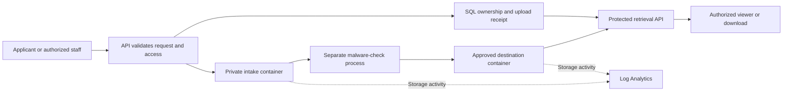

# Azure Storage Accounts, Containers and File Uploads

**Give business files a clear home, protect access and keep recovery options available.**

[Business problem](#the-business-problem) · [Solution](#the-solution) · [What was built](#what-was-built) · [Proof](#proof-it-works) · [Commands](docs/COMMANDS.md)


## The Business Problem

An employee uploads a document, but storing the bytes is only the beginning. Staff need to find the right file, know whose record it belongs to and avoid opening an unchecked or unauthorized copy. Accidental changes and deletions also need a recovery path.

## The Solution

Route application uploads into private Azure Blob Storage. Keep the file's ownership, type and processing status in the application database. Check requests before accepting them, hold new files for malware checking and enforce access again when someone retrieves a document.

**Business outcome:** A consistent document library reduces manual filing and gives staff clearer ownership, access boundaries and recovery options. No numerical time-saving claim is made.

This project covers application uploads and storage management. **[Email ingestion is a separate project](https://github.com/truthofsource/azure-logic-apps-document-ingestion).** Malware scanning is explained in depth in the [file quarantine project](https://github.com/truthofsource/secure-serverless-document-processing).

## Architecture



Intake and trusted documents can use separate storage accounts. The included Terraform module defines the document store; it does not provision the entire API, database or scanner. The diagram explains their relationship, not a complete deployment from this repository.

## What Was Built

| Component | What it does | Code |
| --- | --- | --- |
| Storage infrastructure | Private containers, Entra access, network restrictions, versioning, 30-day deletion recovery and storage logs | [Terraform](infra/storage/main.tf) |
| Upload validation | Checks request shape, file size, byte signatures and whether a packet item may be changed | [Contract](src/contracts/publicStage2DocumentUpload.ts), [rules](src/stage2/stage2DocumentUploadRules.ts) |
| Document filing rules | Chooses the collection from the document type | [Catalog](src/documents/documentCatalog.ts) |
| Access rules | Separates HR, Payroll and Admin library access; rejects unknown roles | [Access](src/documents/documentAccess.ts) |
| Upload handling and retry records | Uses managed identity and checks that retries match the same user, person, file contents and size | [Route](reference/documents-route.ts), [receipt](reference/documentUploadReceipt.ts) |
| New local viewer | Explains the design and displays fictional requests evaluated by the real extracted rules | [Preview](preview/index.html) |

## Proof It Works

### 1. Check actual application rules

```bash
npm test
npm run demo
```

**Observed: 34 tests passed.** They include valid and rejected uploads, role restrictions, accepted-document protection and safe audit fields. Node runs the selected TypeScript files without installing application packages. This is not a full application build or TypeScript type check.

### 2. Check the storage configuration without Azure

```bash
terraform -chdir=infra/storage init -backend=false
terraform -chdir=infra/storage fmt -check -recursive
terraform -chdir=infra/storage validate
terraform -chdir=infra/storage test
```

**Observed: five simulated-provider tests passed**, along with formatting and configuration validation. They check proposed settings without contacting an Azure account. [Validation](docs/VALIDATION.md) records results and limitations.

### 3. Follow an upload


A valid upload request does not mean the file is safe to open. The full application waits for a check of the exact uploaded file version. A retry must match the saved upload record. It cannot submit a different file as the same request.

### 4. Check who can see what


The library filters by document type, even when types share a container. These API rules do not reduce the separate permissions of someone granted direct storage access.

```bash
python -B scripts/preview.py --port 8140
```

Open [the local reference](http://127.0.0.1:8140). Screenshots are real captures of this local demonstration with fictional data, not Azure Portal or live application evidence.

## Strengths, Weaknesses and Tradeoffs

| Choice | Strength | Limit or tradeoff |
| --- | --- | --- |
| Restricted storage with managed identity | Avoids anonymous files and shared account keys | Callers still need network access allowed by the storage rules and valid identity permissions |
| Server-controlled collections | Makes filing consistent | Shared containers still require document-level checks |
| File-version receipts | Helps reconcile retries without accepting different content | SQL and Blob Storage are separate systems; recovery must handle partial work |
| Versioning and soft deletion | Helps recover mistakes | Retained versions cost money and do not replace database or disaster recovery |
| Storage and business audit logs | Explains technical activity and business access | Log volume, retention and sensitive metadata need review |

## Project Guides

| Guide | Purpose |
| --- | --- |
| [Implementation](docs/IMPLEMENTATION.md) | Accounts, containers, upload rules and access boundaries |
| [Commands](docs/COMMANDS.md) | Local validation and read-only Azure inspection examples |
| [Operations and scaling](docs/OPERATIONS-AND-SCALING.md) | Failure handling, recovery, costs and growth |
| [Source map](docs/SOURCE-MAP.md) | Actual source, adaptations and original file hashes |
| [Validation](docs/VALIDATION.md) | What the checks prove and what they do not |

No cloud resources were deployed or started for this project. The GitHub check is manual-only and is not dispatched as part of publication.
